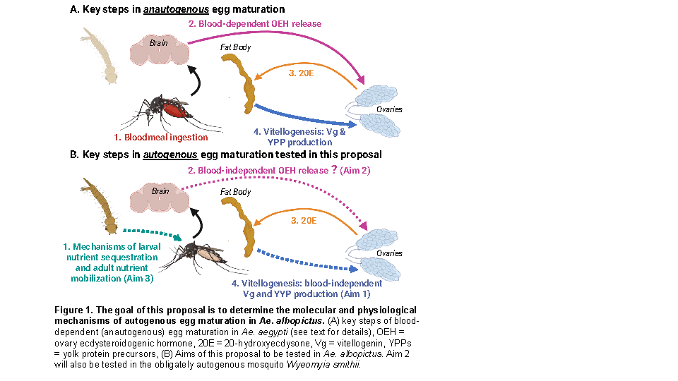

## This is a second-level heading for MasterNotes ##
### This is a third-level heading for MasterNotes ###

The trimmomatic script is [HERE](Scripts/example_trim.SBATCH) 

Next, I'll add a totally unrelated figure...

